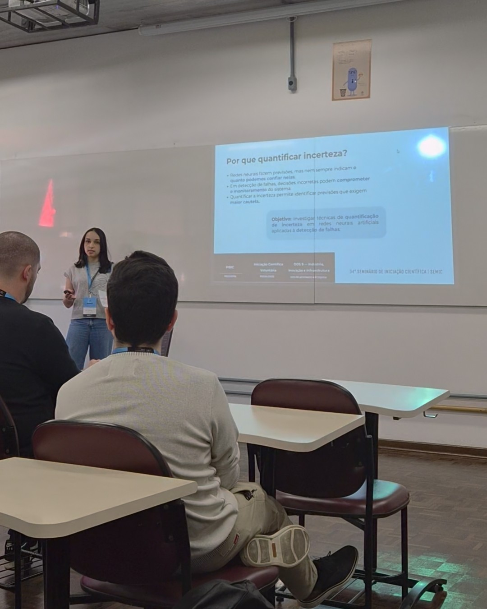

# Uncertainty Estimation in Deep Learning for Anomaly Detection

**Undergraduate Research (PIBIC/ICV) · PUCPR · 2024–2026**

Research project investigating how uncertainty estimation can improve the interpretation of predictions from **1D convolutional neural networks (1D-CNNs)** in water-quality time-series anomaly detection. The study extends an existing anomaly-detection pipeline, comparing **Monte Carlo Dropout** and **Beta-distribution Negative Log-Likelihood (NLL)** approaches.

## Research question

How can uncertainty-aware neural networks contribute to more reliable fault and anomaly detection?

## Methods

- **Baseline:** 1D-CNN architectures for time-series classification, including one shared CNN and a multi-branch CNN with independent feature-processing subnetworks.
- **Data:** water-quality time series with imbalanced `EVENT` labels; the underlying preprocessing/modeling pipeline originated from prior research.
- **MC Dropout:** dropout stays active at inference time. Twenty stochastic forward passes (`T=20`) estimate mean prediction and predictive variation.
- **Beta NLL:** models two positive parameters (`alpha`, `beta`) of a Beta distribution; computes a class-probability estimate and uncertainty without repeated inference passes.
- **Evaluation:** F1-score and estimated predictive uncertainty, comparing model architectures and uncertainty techniques.

## Main results

Values transcribed from the final research report (2026):

| Architecture | Method | F1-score | Mean uncertainty |
|---|---|---:|---:|
| Model 1 | Baseline (no uncertainty) | 0.5346 | — |
| Model 1 | MC Dropout | 0.5798 | 0.0048 |
| Model 2 | Baseline (no uncertainty) | 0.6149 | — |
| Model 2 | MC Dropout | 0.6226 | 0.0051 |
| Model 1 | Beta NLL | 0.5274 | 0.0274 |
| Model 2 | Beta NLL | 0.6243 | 0.0194 |

**Key Findings:** Monte Carlo Dropout improved F1-score in both evaluated CNN architectures while enabling predictive uncertainty estimation. The Beta NLL approach achieved its best result with the multi-branch architecture (F1-score: 0.6243), highlighting the importance of architectural choices in uncertainty-aware deep learning.

The experiments were conducted on a single dataset under computational constraints, so the results should not be interpreted as general benchmarks.

## Repository structure

```text
deep-learning-uncertainty-estimation/
├── notebooks/
│   └── uncertainty_experiments.ipynb
├── media/
│   └── semic-apresentacao.jpg
├── requirements.txt
├── README.md
└── .gitignore
```

## Notebook and reproducibility

The notebook contains preprocessing, 1D-CNN architectures, Monte Carlo Dropout experiments, and Beta NLL models. Code outputs were cleared before publication.

To explore it:

```bash
pip install -r requirements.txt
jupyter notebook notebooks/uncertainty_experiments.ipynb
```

Alternatively, open the notebook in Google Colab and install the required dependencies as needed.

## SEMIC — Research Presentation

This research was presented at **SEMIC 2026 (Scientific Initiation Seminar)** at the Pontifical Catholic University of Paraná (PUCPR).

The presentation covered uncertainty quantification in deep learning, experimental comparisons between Monte Carlo Dropout and Beta NLL, and their application to anomaly detection.

### Research Presentation



## Research context and acknowledgements

Research conducted as part of the **Undergraduate Scientific Initiation program at PUCPR**, by **Ana Flávia Martins dos Santos**, with supervisors **Victor Henrique Alves Ribeiro** and **Gilberto Reynoso Meza**, as identified in the final report. The study extends a previously established water-quality anomaly detection pipeline (Alves Ribeiro et al., 2020), rather than claiming original authorship of that baseline.

## References

- Gal, Y. & Ghahramani, Z. (2016). *Dropout as a Bayesian Approximation: Representing Model Uncertainty in Deep Learning*. https://arxiv.org/abs/1506.02142
- Alves Ribeiro, V. H. et al. (2020). *A novel dynamic multi-criteria ensemble selection mechanism applied to drinking water quality anomaly detection*. Science of the Total Environment, 749, 142368.
- Sensoy, M., Kaplan, L. & Kandhasamy, M. (2018). *Evidential Deep Learning to Quantify Classification Uncertainty*.

## Author

**Ana Flávia Martins dos Santos** · [GitHub](https://github.com/aflavinhams) · [LinkedIn](https://www.linkedin.com/in/ana-flavia-martins-dos-santos-058104281)
